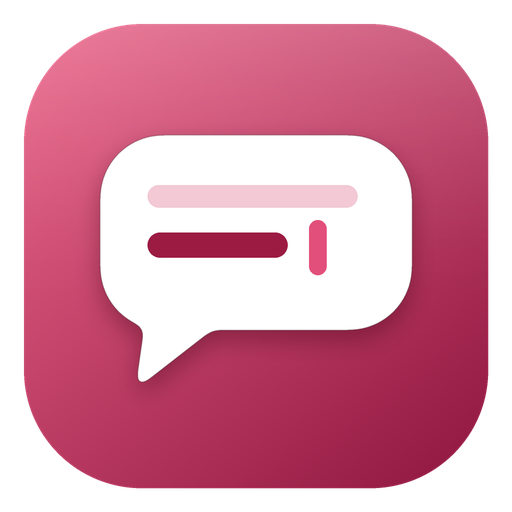
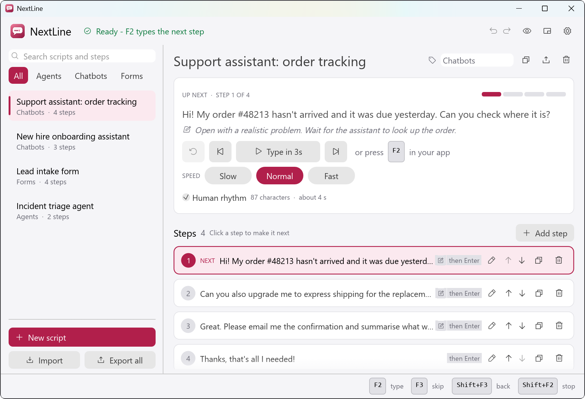
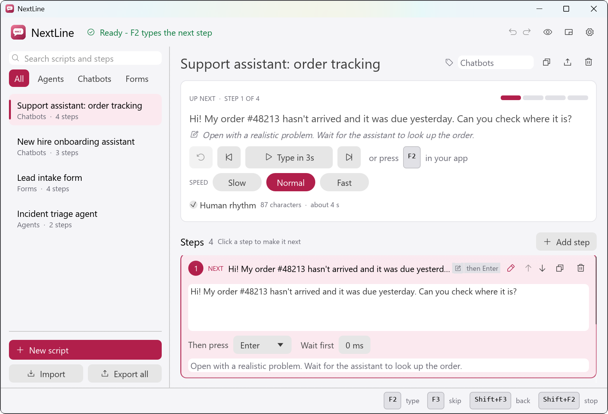
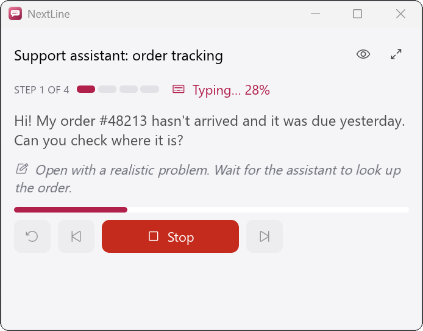

<p align="center">
  
</p>

<h1 align="center">NextLine</h1>

<p align="center"><b>Type your demo script with a single keypress.</b></p>

<p align="center">
  <a href="https://github.com/JW31254/nextline/releases/latest">Download</a> ·
  <a href="#use-it">Use it</a> ·
  <a href="#let-an-ai-agent-write-your-scripts">AI agent skill</a> ·
  <a href="#build-from-source">Build</a>
</p>



NextLine is a small Windows app for live demos. Pre-script every prompt or form value once, click into the app you are
demoing, press **F2**, and the next step types itself with a natural, human-looking rhythm. Then it moves on to the next step.
No live typos, no obviously pasted text, and no clipboard involved.

It is built for chatbot, agent and form demos, but it types into any Windows app that accepts keyboard input.

## Features

- **One key per step.** `F2` types the current step and advances; `F3` skips, `Shift+F3` goes back, `Shift+F2` stops immediately. All rebindable.
- **Human-paced typing.** Slow, Normal or Fast, with pauses at the end of sentences and clauses so it never looks pasted.
- **No clipboard.** Text is sent as real keystrokes, so your clipboard is untouched and emoji and any language work.
- **Press a key afterwards.** Enter for chat boxes, Tab between form fields, and more.
- **Presenter mode** (`Ctrl+M`). A compact, always-on-top window with your next line, private notes and progress.
- **Hide from screen share.** One click excludes the window from screen sharing and recordings (Windows 10 2004+). You still see it.
- **Presenter notes and per-step options.** Private reminders that are never typed, plus an optional wait before a step.
- **Works from the tray.** Hotkeys keep working while the window is hidden.
- **A real library.** Search, categories, duplicate, reorder, undo/redo, light and dark themes, import and export as JSON.
- **Tiny and private.** One executable of about 8 MB, no installer, no account, scripts stay on your machine.

| Editing a step | Presenter mode |
| --- | --- |
|  |  |

## Install

1. Download `NextLine-<version>-win-x64.zip` from the [latest release](https://github.com/JW31254/nextline/releases/latest).
2. Unzip it anywhere and run `NextLine.exe`. There is no installer.

Requires Windows 10 or 11 (64-bit). The app is not code-signed yet, so Windows SmartScreen may ask for confirmation the first time:
choose **More info**, then **Run anyway**. You can also build it yourself from source (below) and compare against the SHA-256 in the release notes.

## Use it

1. Select a script and click the step you want to type next (it is marked **NEXT**). Use the pencil to edit a step.
2. Click into the app you are demoing.
3. Press **F2**.

| Hotkey | Action |
| --- | --- |
| `F2` | Type the current step, then advance |
| `F3` | Skip to the next step |
| `Shift+F3` | Go back one step |
| `Shift+F2` | Stop typing right now (the step is not advanced) |
| `Ctrl+M` | Toggle presenter mode (while NextLine has focus) |
| `Ctrl+Z` / `Ctrl+Y` | Undo / redo script edits |
| `Ctrl+F` | Search scripts |
| `Ctrl+,` | Settings |

Handy details:

- **Type in 3s** on the main window starts typing after a countdown, so you can try a step without a hotkey.
- Multi-line steps type new lines as `Shift+Enter` by default, which is safe in chat boxes where Enter sends. Change it in Settings.
- If nothing types, the target app may be running **as administrator**. Windows blocks input from a normal process into an elevated one, so run NextLine as administrator too.
- Closing the window keeps NextLine in the tray so hotkeys keep working. Use the tray icon's **Quit** to exit.

## Let an AI agent write your scripts

This repo includes an agent skill, [`skills/nextline-scripts`](skills/nextline-scripts), that teaches AI coding agents the NextLine script
format and how to write good demo steps. Ask your agent things like:

> Create a NextLine script for a 5-minute demo of our order-tracking chatbot.
>
> Turn this transcript into a NextLine script, with presenter notes.

The agent writes a `.nextline.json` file, validates it with the included checker, and you load it with **Import** in NextLine.

**Install the skill** by copying the folder to where your agent looks for skills, for example:

| Agent | Folder |
| --- | --- |
| GitHub Copilot (CLI, VS Code) | `~/.copilot/skills/nextline-scripts/` or `.github/skills/nextline-scripts/` in your repo |
| Claude Code | `~/.claude/skills/nextline-scripts/` or `.claude/skills/nextline-scripts/` in your repo |
| Anything else | Point the agent at `skills/nextline-scripts/SKILL.md` and tell it to follow it |

The skill contains `SKILL.md` (instructions), a [JSON Schema](skills/nextline-scripts/schema/nextline-script.schema.json),
[example scripts](skills/nextline-scripts/examples) and `scripts/validate.py` (Python 3, standard library only). You can use the
validator on its own: `python skills/nextline-scripts/scripts/validate.py my-demo.nextline.json`.

## Script files

Export and import use plain JSON. This is the whole format:

```json
{
  "scripts": [
    {
      "title": "Order status chatbot",
      "category": "Chatbots",
      "steps": [
        {
          "body": "Hi! Where is order #48213? It was due yesterday.",
          "afterKey": "enter",
          "note": "Pause here and point out the order lookup."
        }
      ]
    }
  ]
}
```

`afterKey` is one of `none`, `enter`, `tab`, `shiftTab`, `escape`, `space`, `backspace`, `delete`, `arrowUp`, `arrowDown`,
`arrowLeft`, `arrowRight`, `ctrlEnter`, `shiftEnter`. Optional `delayMs` (0 to 60000) waits before a step. Imported scripts always get
fresh IDs, so importing never overwrites anything.

## Privacy and updates

- Scripts and settings live in `%APPDATA%\NextLine\library.json` (with a `library.bak` copy). Nothing is uploaded.
- There is no account and no telemetry.
- The only network request NextLine makes is an optional **update check**: about once a day it asks `api.github.com` for this
  repository's latest release and, if a newer one exists, shows a banner with a link to the release page. It sends nothing about you or
  your scripts (only a `NextLine/<version>` user agent), uses your Windows proxy settings, never runs while a step is typing, and fails
  silently when offline. It never downloads or runs anything. Turn it off or check on demand under **Settings > Updates**.

## Build from source

You need Rust (stable) and the Visual Studio C++ build tools.

```powershell
cargo test                  # unit tests
cargo run --release         # run it
cargo build --release       # target\release\nextline.exe
```

Project layout:

| File | Purpose |
| --- | --- |
| `src/typer.rs` | Plans text into timed actions and sends them with `SendInput` |
| `src/hotkey.rs` | Hotkey parsing and the `RegisterHotKey` listener thread |
| `src/core.rs` | Shared state, typing runner, hotkey dispatch, autosave, update thread |
| `src/model.rs` | Scripts, steps, settings and tolerant JSON import |
| `src/update.rs` | GitHub release check over WinHTTP |
| `src/storage.rs` | Atomic persistence |
| `src/app.rs`, `src/theme.rs` | egui user interface, tray, presenter mode |
| `src/platform.rs` | Single instance, show/hide, capture exclusion |
| `skills/nextline-scripts` | Agent skill, schema, examples and validator |

### Releasing

1. Bump `version` in `Cargo.toml` and add a `## [x.y.z] - date` section to `CHANGELOG.md`.
2. Commit, then `git tag vx.y.z` and `git push --tags`.
3. The [Release workflow](.github/workflows/release.yml) builds on a clean Windows runner with build-machine paths stripped,
   runs the tests, zips `NextLine.exe`, computes the SHA-256 and publishes the release using the changelog section as the notes.

Running copies of NextLine pick the new release up through the update banner.

## Contributing

Issues and pull requests are welcome. Please run `cargo test` before opening a PR.

## License

[MIT](LICENSE)
